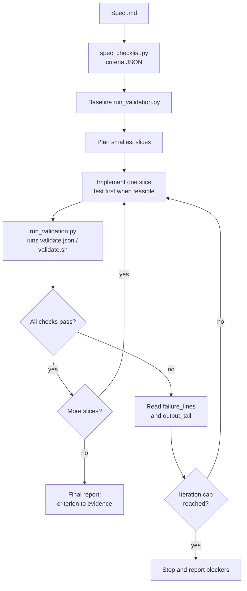

# agent-skills

Coding agents tend to declare a task "done" without proof, and review security by vibes; this repo is a
small set of Agent Skills that make them loop on real command output and review against a fixed checklist.

An original personal project by Mykael Alexandre, written from scratch. MIT licensed.

## Why

- **Spec work needs a loop, not a single pass.** `spec-implementation` forces implement, validate, read
  failures, fix, repeat, and ends with a table mapping each acceptance criterion to evidence the agent
  actually observed.
- **Security review needs a method.** `owasp-security-review` walks OWASP Top 10 (2021) categories in
  order, requires file, line and evidence for every finding, and forbids invented CVEs.
- **Skills are code.** They get a linter and tests, so a typo in frontmatter or a stale example fails CI
  instead of silently breaking an agent.

## Quickstart

```bash
pip install -r requirements-dev.txt
python scripts/validate_skills.py
python -m pytest
```

Try the helper scripts on the bundled example:

```bash
python skills/spec-implementation/scripts/spec_checklist.py skills/spec-implementation/examples/sample-spec.md
python skills/spec-implementation/scripts/run_validation.py --cmd "tests=python -m pytest"
```

## What is inside

| Skill | What it does | Contents |
|-------|--------------|----------|
| [`spec-implementation`](skills/spec-implementation/SKILL.md) | Implements a spec with a bounded validation loop and an evidence report | `scripts/spec_checklist.py`, `scripts/run_validation.py`, `references/`, `examples/` |
| [`owasp-security-review`](skills/owasp-security-review/SKILL.md) | Evidence-based review against OWASP Top 10 (2021) | 10 category checklists, a deliberately vulnerable Flask app, an answer key |

Repo tooling: `scripts/validate_skills.py` (linter), `tests/` (pytest), `.github/workflows/ci.yml`.

## The validation loop



## Using the skills

**Claude Code.** Skills are folders containing `SKILL.md`. Copy one into your personal skills directory
or into a project:

```bash
cp -r skills/spec-implementation ~/.claude/skills/            # available everywhere
cp -r skills/owasp-security-review .claude/skills/            # this project only
```

Then ask for the task in plain words ("implement docs/spec.md and validate it", "security review this PR").
The `description` field in the frontmatter is what the agent uses to decide when to load a skill.

**Cursor and other agents.** The content is plain markdown plus stdlib Python. Point the agent at the
`SKILL.md` (for Cursor, paste or reference it from a project rule) and let it run the scripts by path.
I have only exercised the scripts and linter directly, not every host tool's skill loader.

## Design decisions and trade-offs

- **Scripts do the mechanical parts; the agent does the judgement.** Parsing a spec and running commands
  is deterministic, so it lives in tested Python with JSON output. Deciding whether a failure is a test
  bug or a code bug stays with the model.
- **Stdlib only.** The helpers run anywhere Python 3.10+ exists, with no install step. The cost is a
  hand-rolled frontmatter parser that supports flat `key: value` only, and a regex-based markdown parser.
- **Bounded loop.** Default caps (5 per slice, 15 overall) prevent infinite fix attempts and the
  temptation to weaken tests. The numbers are conventions, not tuned values.
- **Criteria are never auto-marked.** The scripts report command results; mapping a result to a
  criterion is a documented agent step, so "green" cannot silently stand in for "covered".
- **One short file per OWASP category.** Small files are cheap to load on demand instead of putting
  everything in `SKILL.md`. They are my own summaries and link to owasp.org for authoritative text.
- **Answer key is tested.** `expected-findings.md` embeds machine-readable line references and a test
  fails if `app.py` drifts away from it.

## Limitations

- I have not benchmarked these skills against agents or measured outcomes; there are no performance
  claims here. The tests cover the scripts, linter and example consistency, not agent behaviour.
- `spec_checklist.py` understands list-style criteria; tables and Given/When/Then prose need to be
  rewritten as list items (see ROADMAP).
- `run_validation.py` runs commands through the shell with the caller's permissions. It is meant for
  repositories you trust. The `failure_lines` extraction is a heuristic.
- The security review is a code-reading aid. It does not run scanners, check live systems or replace a
  penetration test. The OWASP checklists are summaries and not exhaustive.
- The vulnerable app is for reading, not running. Its pinned dependencies are intentionally old.

## Repository layout

```
skills/
  spec-implementation/   SKILL.md, scripts/, references/, examples/
  owasp-security-review/ SKILL.md, references/A01..A10, examples/
scripts/validate_skills.py
tests/
ROADMAP.md
```

See [ROADMAP.md](ROADMAP.md) for planned increments.
